# 바로전화 (BaroDial)

**삼성 전화를 기본 전화 앱으로 그대로 두고, 검색·연락처·키패드만 더 편하게 쓰는 전화 프런트엔드 앱**

- 화면 하단에 항상 같은 자리에 있는 **큰 검색창**: 이름, 초성(ㄱㅊㅅ), 회사명, 번호 일부(하이픈 없이)로 즉시 검색
- 하단 메뉴 **홈(다이얼) · 연락처 · 최근기록 · 즐겨찾기**, 좌우 스와이프로 이동
- 삼성 전화가 저장한 **통화 녹음**을 최근기록·연락처에서 바로 재생
- 고른 번호는 **삼성 전화로 넘겨서** 발신 → 실제 통화, 수신 화면, 통화 중 화면, **통화 스크리닝은 전부 삼성 전화가 처리**
- 기본 전화 앱 역할(ROLE_DIALER)을 요청하지 않음 · 인터넷 권한 없음 · 광고/추적 SDK 없음

| 홈(다이얼) | 초성 검색 | 번호 검색 | 연락처 |
|---|---|---|---|
| 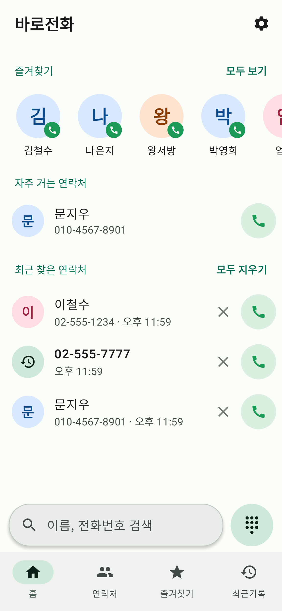 | 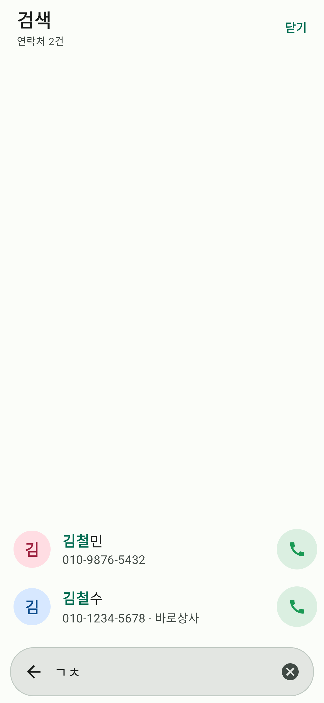 | 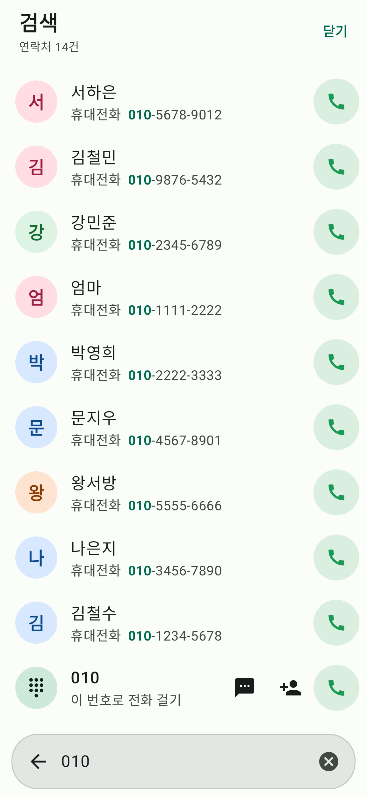 | 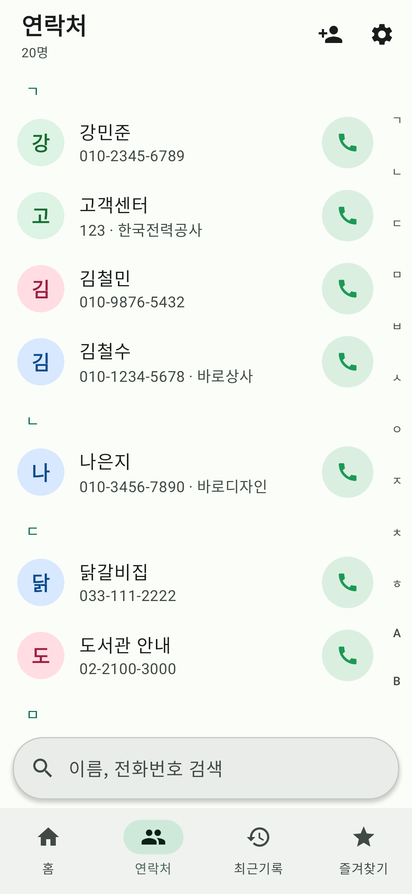 |

| 연락처 상세 | 다이얼 입력 중 | 즐겨찾기 | 최근기록(통화기록 권한 전: 안내 + 통화 녹음) |
|---|---|---|---|
| 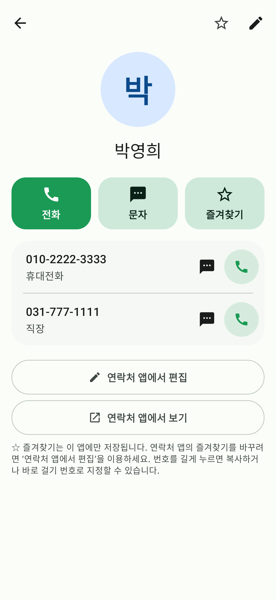 | 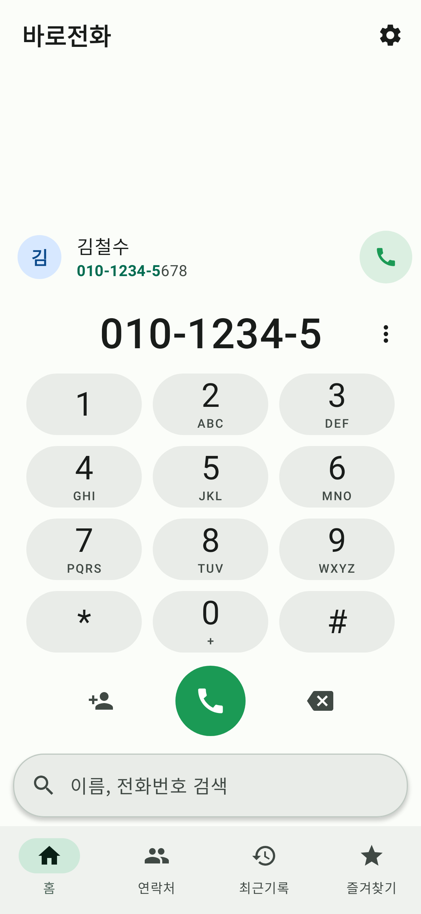 | 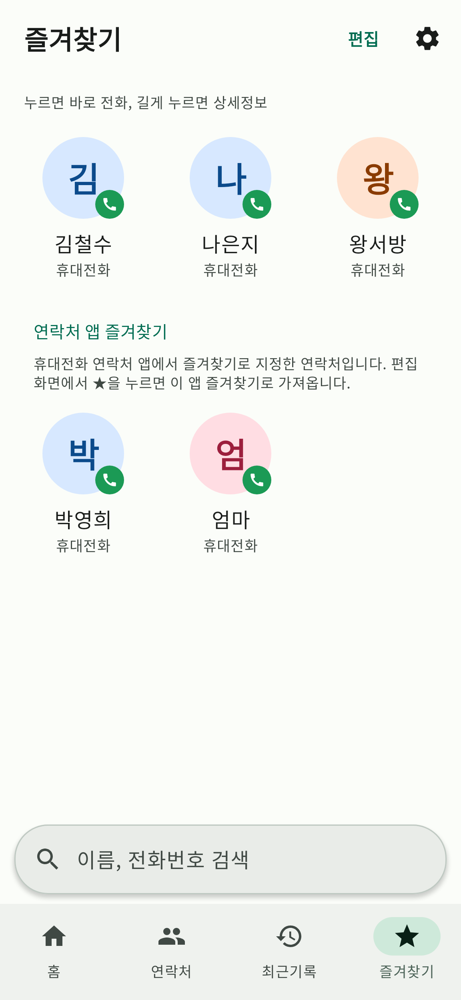 | 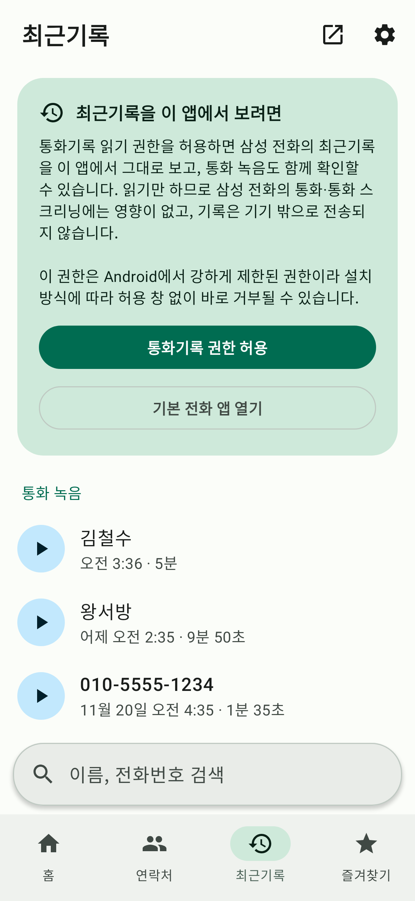 |

| 통화기록 + 녹음 ▶ · 문자 | 상세 통화내역의 녹음 ▶ | 연락처에 없는 번호 상세 | 통화 녹음 연결 진단 |
|---|---|---|---|
| 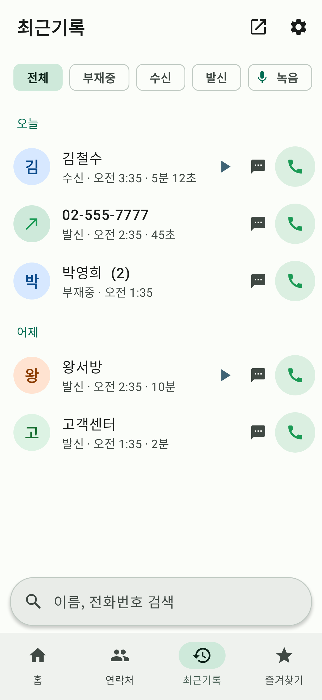 | 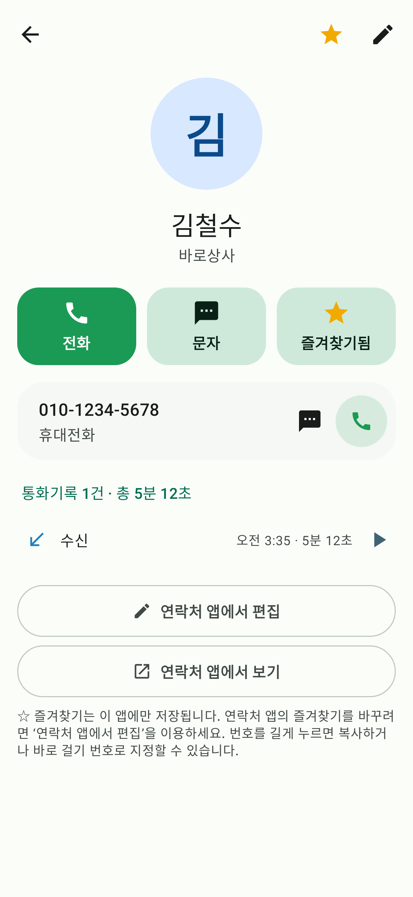 |  | 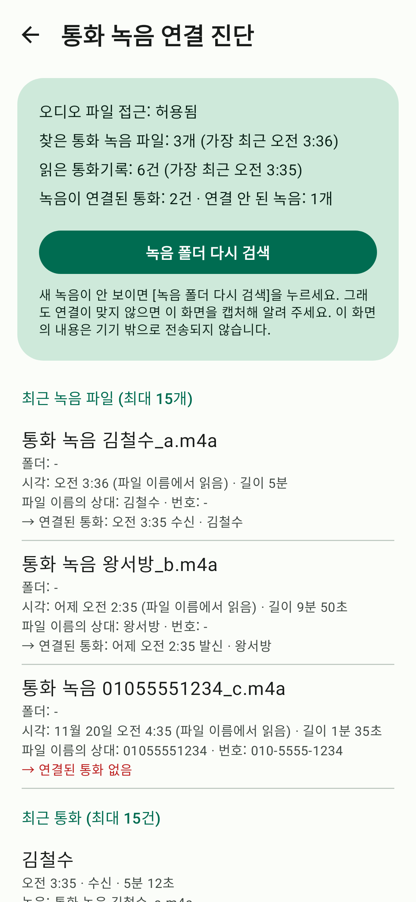 |

펼친 화면(Galaxy Z Fold 내부 화면): 왼쪽은 같은 목록과 하단 검색창, 오른쪽은 키패드 또는 연락처 상세.

| 펼침: 홈 + 키패드 | 펼침: 연락처 + 상세 | 다크 모드 검색 |
|---|---|---|
| 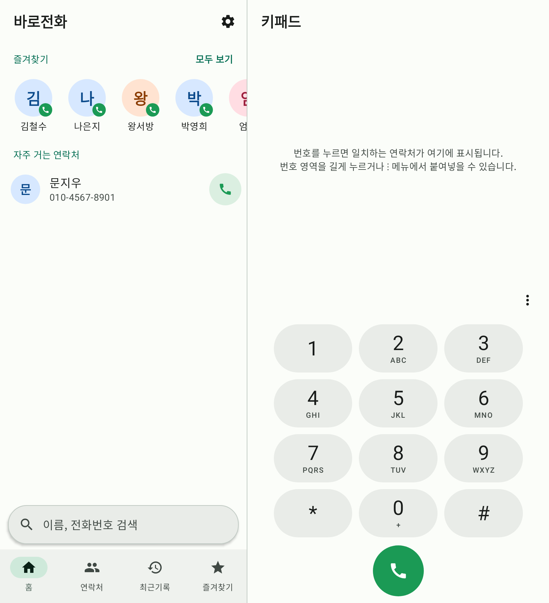 | 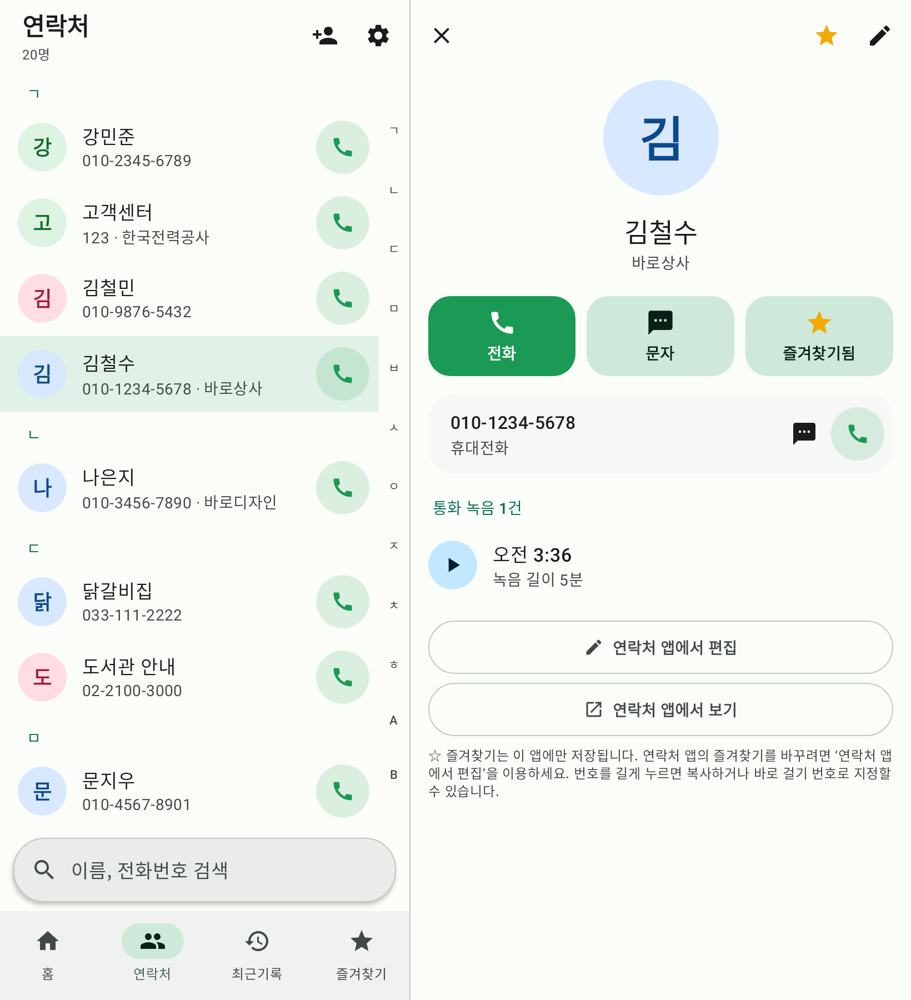 | 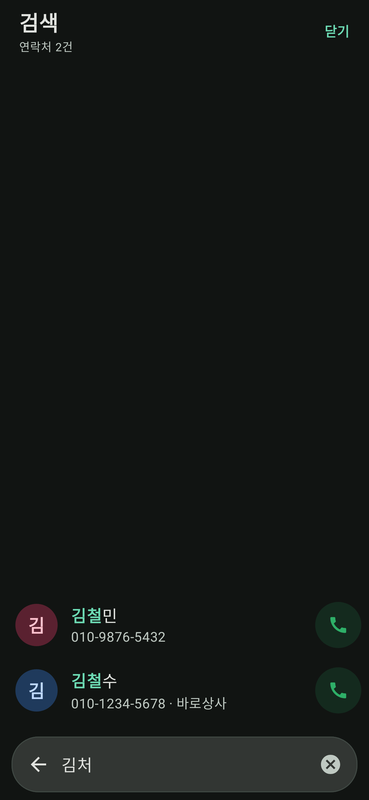 |

> 스크린샷은 테스트 전용 예시 연락처로 Robolectric 테스트에서 자동 생성한 것입니다 (`ScreenshotTest`). 앱 본체에는 예시 데이터가 전혀 들어 있지 않으며 실제 기기의 연락처만 읽습니다.

---

## 1. 설치 (APK)

### 바로 설치할 APK

| 파일 | 설명 |
|---|---|
| [`dist/barodial-1.3.0.apk`](dist/barodial-1.3.0.apk) | 앱 전체 (약 3MB). 1.3.0부터 APK가 하나로 합쳐졌습니다 |

설치 방법에 따라 **최근기록(통화기록)** 동작만 달라집니다.

| 설치 방법 | 통화기록 |
|---|---|
| **PC에서 adb로 설치 (권장)** | 최근기록 탭에서 [통화기록 권한 허용] → 허용 창이 뜨고 통화기록·녹음 ▶·필터가 모두 동작합니다 (사용자 Galaxy Z Fold7에서 확인) |
| 휴대폰에서 APK 파일로 설치 | Android가 통화기록 권한을 막을 수 있습니다. 막히면 이유를 안내하고 삼성 전화의 기록 화면으로 보내 줍니다. 나머지 기능(검색·다이얼·연락처·즐겨찾기·녹음 목록)은 그대로 동작합니다 |

> **업데이트도 adb로 설치하세요** (`adb install -r …`). 휴대폰에서 파일로 덮어쓰면 통화기록 권한이 다시 막힐 수 있습니다.
> 1.2.0 이하의 기본판·실험판 어느 쪽을 쓰고 있었든 1.3.0으로 덮어쓰기 설치됩니다 (같은 앱, 같은 서명 키 `keystore/debug.keystore`). 즐겨찾기·설정은 유지됩니다.

### 휴대폰에서 직접 설치

1. 휴대폰 브라우저에서 위 APK를 내려받습니다.
2. 갤럭시 **자동 차단(Auto Blocker)** 이 켜져 있으면 외부 앱 설치가 막힙니다.
   `설정 › 보안 및 개인정보 보호 › 자동 차단`에서 잠시 끄고 설치한 뒤 다시 켜세요.
3. "출처를 알 수 없는 앱 설치" 허용 창이 뜨면 해당 브라우저(또는 내 파일)에 허용합니다.
4. Play 프로텍트가 검사를 권하면 검사 후 설치합니다.
5. 처음 실행하면 연락처 권한 안내 카드가 나옵니다. **[연락처 권한 허용]** 을 누르세요.
   (허용하지 않아도 키패드로 전화는 걸 수 있습니다)

### PC에서 adb로 설치

1. 휴대폰: `설정 › 휴대전화 정보 › 소프트웨어 정보 › 빌드번호`를 7번 눌러 개발자 모드를 켜고, `설정 › 개발자 옵션 › USB 디버깅`을 켭니다. 자동 차단은 잠시 끕니다.
2. PC: [SDK Platform-Tools](https://developer.android.com/tools/releases/platform-tools)를 받아 `C:\platform-tools`에 풉니다 (Android Studio가 있으면 `%LOCALAPPDATA%\Android\Sdk\platform-tools`에 이미 있음).
3. USB로 연결하고 폰의 "USB 디버깅 허용" 창에서 허용한 뒤:

```bat
cd C:\platform-tools
adb devices
adb install -r "%USERPROFILE%\Downloads\barodial-1.3.0.apk"
```

- `adb devices`에 `기기번호  device`가 보이면 정상입니다 (`unauthorized`면 폰의 허용 창 확인).
- 파일을 못 찾으면 `adb install -r `까지 입력한 뒤 APK 파일을 명령 프롬프트 창으로 끌어다 놓으세요.
- 끝나면 USB 디버깅을 끄고 자동 차단을 다시 켜세요.

### 설치 후 꼭 확인할 것

- `설정 › 애플리케이션 › 기본 앱 선택 › 전화 앱`이 **전화(삼성)** 그대로인지 확인합니다.
- 바로전화의 `설정 › 삼성 전화 연동 상태` 카드에도 현재 기본 전화 앱이 표시됩니다.
- 기기 OS 버전은 `설정 › 휴대전화 정보 › 소프트웨어 정보`에서 확인합니다.
- 이 앱은 Android 10 이상에서 동작하며 Android 16(API 36)을 대상으로 빌드했습니다.

---

## 2. Windows에서 빌드하기

### 준비물

- **Android Studio** 최신 안정판 (AGP 9.4를 지원하는 버전; 2026년 9월 이후 릴리스)
- Android Studio에 포함된 JDK(JBR 21) — 별도 설치 불필요
- **Android SDK Platform 37** (Android 17 SDK)
  - Studio의 `SDK Manager`에서 설치합니다. 없으면 처음 동기화할 때 설치를 제안합니다.
  - AndroidX(core 1.19, Compose 1.12)가 compileSdk 37을 요구합니다.
  - 앱의 실행 대상(targetSdk)은 36(Android 16)입니다.

### Android Studio에서

1. `File › Open` → 이 저장소의 **`barodial`** 폴더를 엽니다.
2. Gradle 동기화가 끝나면 ▶ 실행합니다.

### 명령줄에서 (`gradlew.bat`)

```bat
cd barodial
rem JAVA_HOME 이 없다면 Android Studio 내장 JDK 사용
set JAVA_HOME=C:\Program Files\Android\Android Studio\jbr

gradlew.bat assembleDebug
```

생성되는 APK:

| 명령 | 결과물 |
|---|---|
| `gradlew.bat assembleDebug` | `app\build\outputs\apk\debug\app-debug.apk` |
| `gradlew.bat assembleRelease` | `app\build\outputs\apk\release\app-release.apk` (R8 축소, 약 3MB, 권장) |
| `gradlew.bat testDebugUnitTest` | 단위·UI 테스트 (보고서: `app\build\reports\tests\`) |

- 처음 빌드하면 Gradle 9.8.2가 자동으로 내려받아집니다.
- `local.properties`(SDK 경로)는 Android Studio가 자동으로 만듭니다.
  명령줄만 쓴다면 `sdk.dir=C\:\\Users\\<사용자>\\AppData\\Local\\Android\\Sdk` 한 줄로 만들어 두세요.
- Android Studio가 "AGP 버전 미지원"이라고 하면 Studio를 업데이트하거나 위 명령줄 빌드를 사용하세요.

---

## 3. 삼성 전화와의 연동 구조

```
 ┌──────────────── 바로전화 (이 앱) ────────────────┐
 │ 하단 검색창 · 다이얼 · 연락처 · 즐겨찾기 · 녹음 재생    │
 │                                                   │
 │  번호 선택 ──▶ Intent.ACTION_DIAL + tel:번호        │──┐
 │  (선택) 원터치 ─▶ Intent.ACTION_CALL (CALL_PHONE)   │──┤
 │  문자 ──▶ ACTION_SENDTO smsto:   연락처 편집 ──▶ 연락처 앱 │
 └───────────────────────────────────────────────────┘  │
                                                         ▼
 ┌──────── Android Telecom ─────▶ 기본 전화 앱 = 삼성 전화 ─────────┐
 │ 다이얼 화면 → 발신 · 통화 중 화면 · 수신 화면 · 통화 스크리닝 · 통화기록 │
 └─────────────────────────────────────────────────────────────┘
 수신 전화는 바로전화를 전혀 거치지 않습니다.
```

- **ROLE_DIALER를 요청하지 않습니다.**
  - `InCallService`, `CallScreeningService`, `ConnectionService`를 구현하지 않습니다.
  - 매니페스트에 `DIAL` / `CALL` / `tel:` 인텐트 필터가 없어, 우리 앱이 다른 앱의 발신 요청을 가로채는 일도 없습니다.
  - 테스트(`thisAppIsNotADialIntentHandler`)로 확인했습니다.
- **삼성 전화 패키지명을 하드코딩하지 않습니다.**
  - 발신은 암시적 인텐트로 "현재 기본 전화 앱"에 전달됩니다.
  - 설정 화면은 `TelecomManager.getDefaultDialerPackage()`로 현재 기본 전화 앱을 읽어 보여 줍니다.
- **기본 발신 방식 `ACTION_DIAL`** (권한 불필요)
  - 삼성 전화의 다이얼 화면이 번호가 채워진 채로 열리고, 거기서 통화 버튼을 한 번 더 누릅니다.
- **원터치 발신(실험적, 기본값 꺼짐)**
  - 설정에서 켜고 `CALL_PHONE`을 허용하면 `ACTION_CALL`로 바로 발신합니다. 이때도 통화 화면은 삼성 전화가 띄웁니다.
  - 긴급·특수번호(4자리 이하)와 `* # , ;`가 들어간 코드는 항상 `ACTION_DIAL`로 엽니다.
  - 권한이 사라지면 자동으로 꺼집니다.
  - **실제 기기에서 삼성 통화 화면 동작을 아직 검증하지 않았으므로** 실험 기능으로 분리했습니다.
- 연락처 추가·편집은 시스템 연락처 앱에 맡겨 `WRITE_CONTACTS` 권한이 필요 없습니다.

---

## 4. 통화기록 제약과 대응

### 확인한 사실

- **READ_CALL_LOG는 Android 10부터 "hard-restricted" 권한입니다.**
  - 설치 프로그램(installer)이 허용 목록에 올렸거나, 이 권한과 연결된 역할(기본 전화 앱 등)을 사용자가 앱에 지정한 경우에만 부여됩니다.
  - 허용 목록에 없으면 앱이 요청해도 대화상자 없이 거부되며, 사용자가 수동으로 허용 목록에 올릴 수는 없습니다.
  - 출처: [AOSP Runtime permissions](https://source.android.com/docs/core/permissions/runtime_perms)
- **Google Play 정책**은 SMS·통화기록 권한을 기본 SMS/전화/어시스턴트 처리 앱 등 핵심 기능에 필요한 앱으로 제한합니다.
  - 출처: [Use of SMS or Call Log permission groups](https://support.google.com/googleplay/android-developer/answer/9047303)
  - 이 앱은 Play에 배포하지 않는 개인용 APK지만, 같은 원칙을 따랐습니다.
- `CallLog.Calls.CONTENT_TYPE`(`vnd.android.cursor.dir/calls`)은 공개 API 상수입니다.
  - `ACTION_VIEW`로 이 타입을 열면 AOSP 계열 다이얼러가 통화기록 화면을 보여 줍니다.
  - "다른 앱의 특정 탭을 연다"는 공식 보장은 없습니다.

### 검토한 선택지

| 방법 | 판단 |
|---|---|
| 우리 앱을 기본 전화 앱(ROLE_DIALER)으로 | ❌ 삼성 전화가 기본 앱에서 빠지면 삼성 통화 스크리닝·통화 화면을 잃습니다. 최우선 요구와 정면 충돌 |
| 기본 어시스턴트(ROLE_ASSISTANT)로 등록 | ❌ VoiceInteractionService 등을 구현해 실제 어시스턴트가 되어야 하고 Bixby/Gemini를 대체합니다. 이름만 등록하는 것은 정책 우회이므로 하지 않음 |
| 접근성 서비스·화면 오버레이로 삼성 전화 화면 읽기 | ❌ 금지 (요구사항 및 정책 위반) |
| 일반 앱으로 READ_CALL_LOG 요청 | ✅ 설치 방식에 따라 다름. 1.2.0까지는 실험 빌드로 분리해 검증했고, **사용자 기기에서 adb 설치 시 허용됨을 확인**한 뒤 1.3.0에서 본체에 합침 |
| 삼성 전화의 기록 화면 열기 | ✅ 구현. 기록 화면 → 기본 전화 앱 열기 → 다이얼 화면 순으로 시도 |

### 현재 구현 (1.3.0)

- 매니페스트에 READ_CALL_LOG를 선언하지만, **최근기록 탭에서 [통화기록 권한 허용]을 누를 때만** 요청합니다 (읽기 전용).
- 상태별 동작
  - **허용됨**: 전체/부재중/수신/발신/녹음 필터, 날짜별 묶음, 각 줄의 ▶ 녹음·💬 문자·📞 전화, 사람별 통화 횟수·통화 시간, 검색창에서 통화기록 번호 검색
  - **아직 요청 전**: 허용하면 볼 수 있는 내용을 설명하고 [통화기록 권한 허용] / [전화에서 최근기록 보기] 버튼
  - **거부·차단됨**: hard-restricted 권한이라 파일로 설치하면 막힐 수 있다는 이유, adb 설치·'제한된 설정 허용' 방법을 안내하고 삼성 전화의 기록 화면으로 보내 줍니다
- 어떤 경우에도 가짜·흉내 기록은 표시하지 않습니다.
- 삼성 전화의 기본 앱 지위와 통화 스크리닝에는 영향이 없습니다 (읽기 권한만 사용).
- 일부 제조사 Provider가 개수 제한을 정렬보다 먼저 적용하는 문제를 피하려고, 통화기록은 개수 제한 없이 읽은 뒤 앱에서 최신순으로 정렬해 최근 5,000건까지 씁니다.
- 앱의 나머지 부분은 `CallHistoryRepository` 인터페이스만 사용합니다 (테스트에서는 가짜 구현으로 교체).

### 설치 방식별 권한 (참고)

- AOSP의 `pm install`(adb)은 `--restrict-permissions` 옵션을 주지 않으면 제한 권한을 허용 목록에 올리는 것으로 알려져 있고, 사용자 Galaxy Z Fold7에서 실제로 허용되는 것을 확인했습니다.
- 휴대폰에서 파일로 설치한 경우에는 앱 정보의 ⋮ 메뉴에 "제한된 설정 허용"이 보일 수 있습니다. 기기·OS 버전에 따라 다릅니다.

---

## 5. 삼성 통화 스크리닝 유지 확인 체크리스트

설치 후 실제 기기에서 아래를 확인해 주세요.

- [ ] `설정 › 애플리케이션 › 기본 앱 선택 › 전화 앱`이 **전화(삼성)** 다
- [ ] 바로전화 `설정 › 삼성 전화 연동 상태`에 "기본 전화 앱: 전화 (com.samsung…)"와 "기본 전화 앱 역할을 사용하지 않습니다 ✓"가 보인다
- [ ] 다른 휴대폰으로 전화를 걸면 **삼성 수신 화면**이 뜬다 (바로전화 실행 중에도)
- [ ] 삼성 전화에서 통화 스크리닝을 켠 상태로 모르는 번호 전화를 받으면 **스크리닝이 평소처럼 동작**한다
- [ ] 바로전화 검색 결과의 📞 버튼 → 삼성 다이얼 화면에 번호가 채워져 열리고, 통화 버튼으로 발신된다
- [ ] 통화 중 화면은 삼성 통화 화면이며, 통화가 끝나면 삼성 전화 최근기록에 정상 기록된다
- [ ] 홈(다이얼)에서 번호 입력 → 초록 버튼 → 위와 동일하게 삼성 전화로 넘어간다
- [ ] 다른 앱에서 번호를 복사한 뒤 홈을 열면 [복사한 번호 붙여넣기]가 보이고, 누르면 번호가 채워진다
- [ ] 최근기록 탭에서 녹음된 통화 옆 ▶ 를 누르면 녹음이 재생된다 (오디오 파일 접근 허용 후)
- [ ] 최근기록 탭의 [전화에서 최근기록 보기]가 삼성 전화의 기록 화면 또는 전화 앱을 연다 (어느 화면이 열리는지 기록해 두기)
- [ ] (선택) 원터치 발신을 켜면 삼성 통화 화면으로 바로 넘어가고, 듀얼 SIM이면 SIM 선택이 정상적으로 나온다
- [ ] 112·119 같은 번호는 원터치 발신을 켜도 다이얼 화면으로 열린다
- [ ] 바로전화를 삭제해도 전화 기능에 아무 변화가 없다

---

## 6. 구현된 기능

**하단 고정 검색창 (최우선)**
- 홈·연락처·최근기록·즐겨찾기 탭에서 같은 위치, 같은 크기(높이 58dp, 둥근 알약 모양)로 표시됩니다. 테스트로 위치가 같음을 확인했습니다.
- 검색창을 누르면 **최근 찾은 연락처**가 먼저 보입니다 (검색 기록).
- 알약 아무 곳이나 누르면 바로 입력이 시작되고, 키보드가 열려도 검색창이 키보드 바로 위로 올라옵니다.
- 지우기 버튼, 뒤로(검색 닫기), 결과를 스크롤하면 키보드가 내려갑니다.
- **가장 잘 맞는 결과를 검색창 바로 위**에 놓아 엄지로 바로 누를 수 있습니다 (설정에서 위→아래 순서로 변경 가능).
- 발신하면 검색을 닫고 원래 화면으로 돌아갑니다 (설정 가능). 결과에서 상세로 들어갔다 뒤로 오면 검색 결과가 그대로 있습니다.
- 런처 아이콘을 길게 누르면 **[검색] / [키패드] 바로가기**가 있습니다.

**한국어 통합 검색**
- 이름, 이름 일부, **초성**(ㄱㅊㅅ), 초성+글자 혼합(김ㅊㅅ)
- 키보드에서 **조합 중인 글자**도 검색합니다: "김처"(철 입력 중), "철"(처리 입력 중), "달"(닭), "오"(왕)
- 회사명·직함, 별명, 모든 전화번호
  - 하이픈 무시, +82 국제형식 저장 번호도 010으로 검색
  - 앞자리·끝자리·중간 일치
- 이 앱의 최근 검색·발신 번호, 통화기록 번호 (통화기록 권한이 있을 때)
- 점수 순서: 정확 일치 > 앞부분 일치 > 단어 시작 > 중간 일치, 이름 > 별명 > 회사
- 동점이면 즐겨찾기·발신 횟수 순, 그다음 가나다순
- 일치 구간을 굵게 강조합니다.
- 메모리 색인을 쓰며, 연락처 5,000명 기준 검색 1회 평균 약 2ms입니다 (JVM 테스트 측정).

**연락처**
- 가나다순 정렬 (한글 → 영문 → 숫자·기호), ㄱ ㄴ ㄷ 고정 머리글
- 오른쪽 **초성 빠른 스크롤**: 끌면 큰 글자 말풍선과 진동이 나옵니다.
- 사진 또는 이니셜 원, 대표 번호 표시, 각 줄의 📞 버튼으로 바로 발신
- 연락처가 바뀌면 자동으로 다시 읽습니다 (ContentObserver).

**연락처에 없는 번호**
- 최근기록에서 연락처에 없는 번호를 누르면 **번호 상세**가 열립니다: 전화·문자·연락처 추가, 그 번호의 통화내역(녹음 ▶).

**연락처 상세**
- 전화·문자·즐겨찾기 큰 버튼, 여러 번호 각각 발신·문자
- 번호를 길게 누르면 복사하거나 "이 번호로 바로 걸기"로 지정할 수 있습니다.
- 번호가 여러 개인데 기본 번호가 없으면 번호 선택 시트가 뜹니다. "다음부터 이 번호로"를 고를 수 있습니다.
- 편집·보기는 시스템 연락처 앱으로 엽니다.

**홈 = 다이얼 (키패드)**
- 접힌 화면의 홈 탭이 곧 다이얼입니다. 위쪽에 즐겨찾기 줄, 아래쪽에 키패드가 있습니다.
- 펼친 화면에서는 오른쪽 창이 항상 키패드이고, 홈 탭에는 즐겨찾기와 자주 거는 연락처가 보입니다.
- 큰 버튼, 넉넉한 간격, 진동, **키패드 톤** (시스템 설정 '다이얼 키패드 톤'과 벨소리 모드를 따름)
- 한국 번호 형식을 입력 중에 바로 적용합니다 (010-1234-5678, 02-123-4567, 1588-1234, +82 …).
- 입력한 번호와 일치하는 연락처를 숫자 위에 표시합니다.
- **복사한 번호 붙여넣기**
  - 클립보드에 텍스트가 있으면 [복사한 번호 붙여넣기] 버튼이 나타납니다.
  - "연락처: 010-1234-5678 (회사)"처럼 글자가 섞여 있어도 번호만 뽑아 넣습니다.
  - 클립보드 내용은 버튼을 누를 때만 읽으므로 Android의 클립보드 알림이 뜨지 않습니다.
- 번호 옆 **⋮ 메뉴**: 붙여넣기, 번호 복사, 연락처에 추가, 문자, 2초간 대기 추가(,), 대기 추가(;)
- ⌫ 한 글자 지우기, 길게 누르면 전체 삭제, 0을 길게 누르면 +, 번호 영역을 길게 누르면 메뉴
- 빈 상태에서 통화 버튼을 누르면 마지막으로 건 번호를 채웁니다 (삼성 전화와 같은 동작).

**탭 이동**
- 하단 메뉴 순서: **홈 · 연락처 · 최근기록 · 즐겨찾기**
- 화면을 **좌우로 밀어** 탭을 넘길 수 있습니다. 하단 메뉴를 눌러도 같은 화면으로 넘어갑니다.
- 연락처 탭의 오른쪽 초성 막대는 세로로 끌 때만 반응하고, 가로로 밀면 탭 넘김에 양보합니다.

**통화 녹음**
- 녹음은 삼성 전화의 통화 녹음 기능이 하고, 바로전화는 저장된 녹음 파일을 찾아 보여 주고 재생합니다.
- 필요한 권한: 오디오 파일 읽기(READ_MEDIA_AUDIO). 최근기록 탭이나 설정에서 허용합니다. 통화기록 권한과 달리 일반 허용 창으로 받는 권한입니다.
- 조회 범위: `Recordings/Call`·`Call` 폴더, 또는 이름이 "통화 녹음"/"Call recording"으로 시작하는 파일만 조회합니다 (음악 등은 제외).
- 파일 이름의 상대 이름·번호와 시각으로 통화기록·연락처와 연결합니다.
  - 지원 형식 예: `통화 녹음 홍길동_231115_143022.m4a`, `Call recording 010-1234-5678_20231115_143022.m4a`
  - 시각이 없으면 파일 수정 시각으로 추정합니다.
- 연결 규칙 (1.2.0)
  - 파일 이름의 번호가 다르면 연결하지 않고, 이름은 공백·기호를 무시하고 한쪽이 다른 쪽을 포함해도 같은 사람으로 봅니다 (괄호 이름 `정세영(레아)` 포함).
  - 녹음 시각이 통화 시작 90초 전 ~ 통화 종료 2분 후 사이이고, 녹음 길이가 통화 길이보다 20초 넘게 길지 않아야 합니다.
  - 여러 후보가 있으면 시각 차이가 가장 작은 짝부터 연결합니다 (이름이 같으면 우선).
- 표시 위치
  - 최근기록(통화기록 있음): 녹음된 통화에 ▶ 버튼, [녹음] 필터 (다른 탭에 갔다 오면 '전체'로 돌아감)
  - 최근기록(통화기록 권한 전·차단 시): 안내 아래에 통화 녹음 파일 목록
  - 연락처 상세·번호 상세: **통화내역 각 줄에 ▶**, 통화와 연결되지 않은 녹음은 '그 밖의 통화 녹음'
- **설정 › 통화 녹음 연결 진단**: 찾은 녹음 파일 수, 읽은 통화기록 수, 최근 녹음 파일별 폴더·시각(파일 이름/수정 시각 중 어디서 읽었는지)·연결된 통화를 보여 줍니다. [녹음 폴더 다시 검색]으로 Android 미디어 목록에 녹음 폴더를 다시 등록하게 할 수 있습니다.
- 재생 창: 재생/일시정지, 위치 이동 막대, 10초 앞뒤, [다른 앱으로 열기]. 앱이 화면에서 사라지면 일시정지합니다.

**즐겨찾기**
- 앱 즐겨찾기(기기에만 저장, 순서 편집 가능)와 연락처 앱 즐겨찾기(STARRED, 읽기 전용)를 함께 보여 줍니다.
- 시스템 즐겨찾기는 쓰기 권한 없이 "앱 즐겨찾기로 가져오기"를 할 수 있습니다.
- **탭하면 바로 전화, 길게 누르면 상세정보**
- 홈(다이얼) 위쪽에도 즐겨찾기 줄을 보여 줍니다.

**폴더블·접근성**
- 너비 600dp 이상(펼친 화면, 큰 분할 창)이면 2단: 왼쪽 목록·검색창, 오른쪽 키패드 또는 상세
- 접고 펼쳐도 검색어, 스크롤, 포커스, 열린 상세가 유지됩니다.
  - `movableContentOf`와 ViewModel을 쓰고, `configChanges`로 액티비티를 다시 만들지 않습니다. 테스트로 확인했습니다.
- 회전·분할화면을 지원하고, 키패드는 화면 높이에 맞게 버튼 크기를 조절합니다 (최대 폭 420dp).
- 글자 크기 130%에서도 깨지지 않습니다 (스크린샷 `folded_11/12_large_font`).
- 모든 터치 영역은 48dp 이상이고 TalkBack 설명을 달았습니다.

**디자인**
- Material 3, 라이트/다크/시스템, 배경화면 색상(Material You)
- 통화 버튼은 의미가 고정된 초록색, 부드러운 전환 애니메이션

**설정 (DataStore, 재시작 후 유지)**
- 테마, 배경화면 색상, 시작 탭, 결과 위치, 발신 후 검색 닫기, 검색기록 저장/삭제
- 원터치 발신(실험), 키패드 진동, 연락처 앱 즐겨찾기 표시
- 권한 상태, 기본 전화 앱 확인, 기본 앱 설정 바로가기

**개인정보**
- **INTERNET 권한 없음** (APK 매니페스트로 확인). 녹음 파일도 기기 밖으로 나가지 않습니다.
- `allowBackup=false`, 데이터 추출 규칙으로 클라우드 백업과 기기 이전에서 제외합니다.
- 연락처는 읽기 전용입니다.

---

## 7. 테스트 결과

빌드 환경: Linux 클라우드 컨테이너, JDK 21, AGP 9.4.1, Gradle 9.8.2, Kotlin 2.4.21, compileSdk 37 / targetSdk 36 / minSdk 29.

| 항목 | 결과 |
|---|---|
| `assembleDebug` | ✅ 성공 |
| `assembleRelease` (R8 축소) | ✅ 성공 (각 약 3MB) |
| Android Lint | ✅ 오류 0 (경고는 "더 새 버전 있음"류) |
| 단위·UI 테스트 (`testDebugUnitTest`) | ✅ 118개 통과 (통화기록 Provider 읽기 테스트 포함) |

테스트 범위:

- **한글**: 초성 추출, 조합 중 글자, 겹받침·이중모음
- **검색 엔진**: 사용자 예시인 김철수 / ㄱㅊㅅ / 철수 / 0101234 / 한국전력, 별명, 영문, 순위, 5,000명 성능
- **번호**: 형식화 30여 가지, +82 변환, 다이얼 문자 정리, 긴급번호
- **정렬과 저장**: 가나다 정렬, 목록 인코딩
- **DataStore**: 설정·즐겨찾기·검색기록이 **앱 재시작 후 유지**됨 (실제 파일로 검증)
- **Contacts Provider 파싱**: 가짜 Provider로 중복 번호 합치기, 기본 번호, 회사, 별명, 이름 없는 연락처, 권한 거부 시 미조회
- **발신 인텐트**
  - `ACTION_DIAL tel:`, `#` 인코딩
  - 우리 앱이 DIAL/CALL/tel: 처리기가 아님
  - 기본 전화 앱을 Telecom에서 읽음
- **ViewModel**
  - 검색, 발신 기록, 번호 선택·기억, 원터치 발신 권한·긴급번호, 키패드 재발신
  - 뒤로가기 순서, 즐겨찾기, 권한 거부 시 동작
- **Compose UI (Robolectric)**
  - 모든 탭에서 검색창 위치 동일, 초성 검색 → 발신 인텐트
  - 키패드 입력·지우기·길게 지우기, 권한 거부 시 안내와 키패드 동작
  - 최근기록에 가짜 기록 없음, 즐겨찾기 탭/길게 누르기
  - **접기↔펼치기 상태 유지**
  - 하단 메뉴 순서와 **좌우 스와이프** (초성 막대가 가로 스와이프를 막지 않음, 세로 끌기는 그대로 동작)
  - **복사한 번호 붙여넣기**, ⋮ 메뉴 붙여넣기·대기 추가
  - 녹음된 통화 ▶ → 재생 창, 통화기록 권한 전의 녹음 목록, 오디오 권한 요청
  - 통화기록 권한 요청 → 차단 시 안내와 삼성 전화로 이동, 각 줄의 문자 버튼
- **통화 녹음**: 파일 이름 해석 (한글·영문 형식, 번호가 날짜로 오인되지 않음), 통화·연락처 연결 규칙, 가짜 MediaStore로 조회·권한 확인

1.2.0 수정: 일부 제조사 통화기록 Provider는 개수 제한(limit) 매개변수를 정렬보다 먼저 적용해 **오래된 기록만** 돌려줄 수 있습니다. 그러면 최신 통화와 그 녹음이 목록에서 빠집니다. 개수 제한 없이 읽은 뒤 앱에서 최신순으로 정렬하도록 바꾸고, 이를 확인하는 테스트를 추가했습니다.

참고: 전체 테스트 중 ViewModel 테스트가 가끔 시간 초과로 실패하던 원인을 1.1.0에서 찾아 고쳤습니다. 검색어 관찰(snapshotFlow)이 백그라운드 스레드에서 시작되면, 시작 직후의 입력 변경을 놓칠 수 있는 경쟁 상태였습니다. 관찰은 메인 스레드에서 하고 검색 계산만 백그라운드에서 하도록 바꿨습니다.

**수행하지 못한 것:**

- 실제 Galaxy Z Fold7에서의 설치·동작 확인 (기기 없음)
- 에뮬레이터 실행 (빌드 환경에 하드웨어 가속(KVM)이 없음)
- 삼성 전화의 통화 스크리닝·원터치 발신·통화기록 화면 열기의 실제 동작 확인
- 삼성 통화 녹음 파일의 실제 저장 폴더·파일 이름 형식 확인 (공식 문서가 없어 여러 형식을 지원하도록 만듦)

위 항목은 [5장 체크리스트](#5-삼성-통화-스크리닝-유지-확인-체크리스트)로 사용자 기기에서 확인해야 합니다.

---

## 8. 미구현 기능과 이유

| 기능 | 상태 | 이유 |
|---|---|---|
| 파일로 설치했을 때의 통화기록 | 제한 | READ_CALL_LOG는 hard-restricted 권한이라 휴대폰에서 파일로 설치하면 Android가 막을 수 있습니다. adb로 설치해야 합니다 (막히면 삼성 전화 기록 화면으로 안내) |
| 삼성 전화의 "최근기록 탭"을 정확히 여는 것 | 부분 | 다른 앱의 특정 탭을 여는 공식 API가 없습니다. 통화기록 인텐트 → 전화 앱 열기 → 다이얼 화면 순으로 대체합니다 |
| 원터치 발신 정식 지원 | 실험 기능 | 실제 삼성 통화 화면 동작을 아직 검증하지 못했습니다 |
| 에이닷 전화 화면 분석 | 미수행 | 빌드 환경에서 공식 안내·공개 스크린샷 페이지에 접근하지 못했습니다. 그래서 "하단 큰 검색창"이라는 사용자 설명과 일반적인 한 손 조작 원칙으로 독자적으로 설계했습니다. 에이닷의 코드·아이콘·상표는 쓰지 않았고, 아이콘은 Material Icons(Apache 2.0)입니다 |
| 앱 안에서 연락처 편집, 시스템 즐겨찾기 쓰기 | 의도적 미구현 | WRITE_CONTACTS 없이 시스템 연락처 앱에 맡깁니다 |
| 이 앱에서 직접 통화 녹음 | 불가 | Android는 기본 전화 앱이 아닌 앱의 통화 음성 녹음을 막습니다. 녹음은 삼성 전화 기능을 쓰고, 이 앱은 재생만 합니다 |

## 9. 다음 버전에서 개선할 점

1. 실기기 체크리스트 결과를 반영합니다.
   - 원터치 발신을 정식 기능으로 할지 결정
   - 실제 녹음 파일 이름 형식에 맞춰 통화 연결 규칙 보정
2. 영문 자판 오타 변환 검색 (`rlacjftn` → 김철수)
3. 키패드 초성 검색 (천지인 방식 숫자 → 자음)
4. 홈 화면 검색 위젯, 빠른 설정 타일
5. Fold 반 접힘(Flex 모드): `WindowManager.FoldingFeature`로 위 절반은 결과, 아래 절반은 키패드
6. 즐겨찾기 끌어서 순서 바꾸기, 연락처 그룹·라벨 필터
7. Baseline Profile로 첫 실행 속도 개선, 사진 캐시 개선
8. TalkBack 실기기 점검

## 10. 프로젝트 구조

```
barodial/
├─ app/src/main/java/io/github/herfar/barodial/
│  ├─ MainActivity.kt, BaroDialApplication.kt, AppContainer.kt (수동 DI)
│  ├─ core/   hangul/ (초성·조합·매칭), phone/ (한국 번호), text/ (가나다 정렬), util/
│  ├─ data/   contacts/ (ContactsRepository, Contacts Provider 읽기)
│  │          search/ (ContactSearchEngine)
│  │          favorites/ history/ settings/ (DataStore)
│  │          calllog/ (CallHistoryRepository, CallLog Provider 읽기, 묶음·통계)
│  │          recordings/ (통화 녹음: MediaStore 조회, 파일 이름 해석, 통화 연결)
│  ├─ dial/   DialerLauncher (발신·문자·연락처 앱 위임, 기본 전화 앱 확인)
│  └─ ui/     MainViewModel, BaroDialApp (접힘/펼침 레이아웃)
│             components/ (하단 검색창 등), home/ contacts/ dialer/ favorites/ recents/ search/ settings/ theme/ icons/
├─ app/src/test/…      단위·Robolectric·Compose UI·스크린샷 테스트
├─ dist/               설치용 APK
├─ docs/screenshots/   자동 생성 스크린샷
└─ keystore/           공용 디버그 서명 키 (개인 설치용)
```

### 참고 사항

- 이 폴더는 `her-far.github.io` 저장소 안에 있습니다. `main`에 병합하면 GitHub Pages 사이트에서 APK와 소스 파일도 공개 주소로 열립니다.
- `keystore/debug.keystore`의 비밀번호는 공개값(`android`)인 디버그용 키입니다. 개인 설치 외 배포(Play 등)에는 새 키를 만들어 쓰세요.
